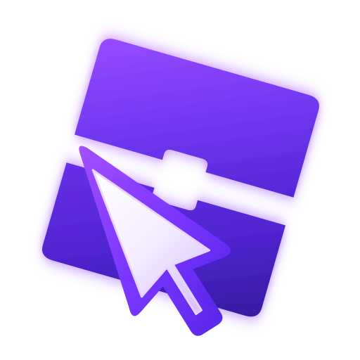
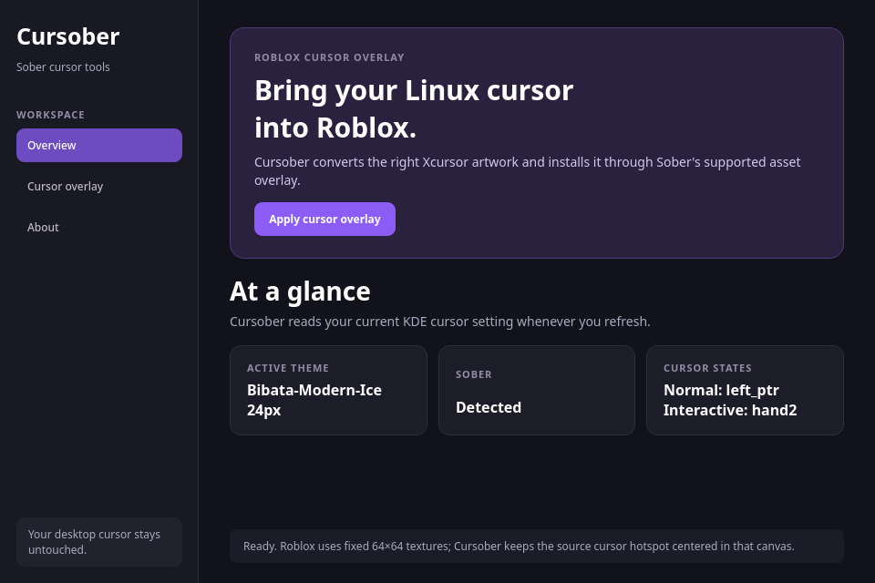

# Cursober

**Cursober brings your active Linux cursor theme into Sober's Roblox cursor overlay.**

Sober runs the Android Roblox client and does not expose a supported way to draw the host compositor's cursor directly. It does, however, support an asset overlay for Roblox's built-in cursor textures. Cursober turns the relevant Xcursor artwork from your current theme into compatible PNG textures—without changing your desktop theme or modifying Sober itself.

<p align="center"></p>

<p align="center"></p>

## What it does

On KDE, Cursober reads the cursor theme selected in `~/.config/kcminputrc`, finds that theme in the normal icon directories, and applies these mappings when they exist:

| Roblox overlay | Theme cursor | Purpose |
| --- | --- | --- |
| `ArrowFarCursor.png` | `left_ptr` | Normal cursor |
| `ArrowCursor.png` | `hand2` | Interactive / button hover cursor |

It saves PNGs only to Sober's documented overlay path:

```
~/.var/app/org.vinegarhq.Sober/data/sober/asset_overlay/
└── content/textures/Cursors/KeyboardMouse/
    ├── ArrowCursor.png
    └── ArrowFarCursor.png
```

Before each apply, Cursober records the existing overlay files in:

```
~/.var/app/org.vinegarhq.Sober/data/sober/cursober-backups/
```

Use **Restore latest backup** to reverse the most recent apply operation, then restart Sober.

## Install and use

1. Download `Cursober-x86_64.AppImage` from the latest release.
2. In Dolphin: right-click it → **Properties** → **Permissions** → enable **Is executable**.
3. Open it, confirm the detected theme and cursor mapping, then choose **Apply to Sober**.
4. Restart Sober.

The AppImage does not change the system cursor theme. It only writes the two files above and makes a backup first.

## Requirements

* Linux on x86_64.
* [Sober](https://sober.vinegarhq.org/) installed as Flatpak and launched at least once.
* A KDE/Xcursor theme installed under `~/.local/share/icons`, `~/.icons`, `/usr/local/share/icons`, or `/usr/share/icons`.

## Limitations

* Sober/Roblox currently supplies only the two verified cursor texture slots listed above. Text, loading, resize, and animated cursor states cannot be overlaid safely yet.
* Roblox stores the cursor artwork in a fixed 64×64 canvas. Cursober preserves the Xcursor hotspot by aligning it to the canvas center and keeps the original frame size whenever it fits.
* Some Roblox expe- I meant games replace their own cursor assets. Those may not use Sober's base cursor textures.

## Build from source

For a local development run:

```bash
python3 -m pip install PySide6
python3 src/cursober.py
```

To check the detected theme without changing anything:

```bash
python3 src/cursober.py --self-test
```

To build the AppImage, install `PySide6`, `PyInstaller`, `rsvg-convert`, and download the official `appimagetool` AppImage. Then run:

```bash
APPIMAGETOOL=/path/to/appimagetool-x86_64.AppImage packaging/build-appimage.sh
```

The build script creates `Cursober-x86_64.AppImage` in the project root.

## Credits

Built for [Sober](https://github.com/vinegarhq/sober)'s supported asset-overlay mechanism. The included icon artwork is original Cursober artwork.
