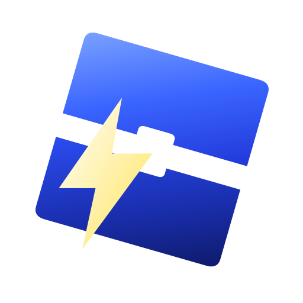
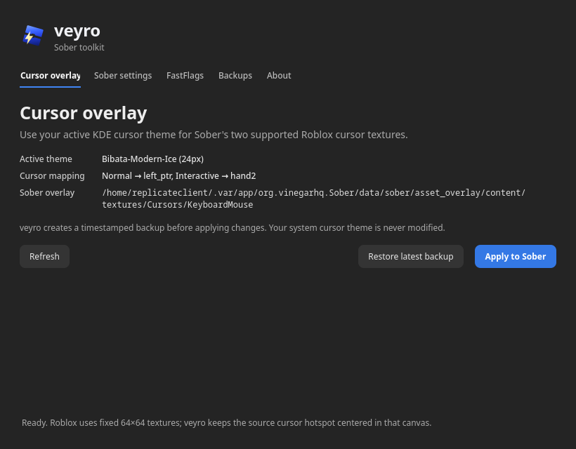

# veyro

**A small Sober toolkit for Linux.**

veyro keeps useful Sober controls in one focused desktop app: cursor-overlay setup, documented Sober settings, and categorized FastFlags. It is built for the Flatpak version of Sober and stays out of Roblox and Sober internals.

<p align="center"></p>

<p align="center"></p>

## Included tools

### Cursor overlay

Sober cannot use the host compositor cursor directly, but it supports an asset overlay for its built-in Roblox cursor textures. veyro reads KDE's active Xcursor theme, converts the original artwork to transparent PNGs, and writes only to Sober's documented overlay directory.

| Sober texture | KDE theme cursor | State |
| --- | --- | --- |
| `ArrowFarCursor.png` | `left_ptr` | Normal cursor |
| `ArrowCursor.png` | `hand2` | Interactive / button hover |

Before applying an overlay, veyro saves the existing files in:

```
~/.var/app/org.vinegarhq.Sober/data/sober/veyro-backups/
```

Use **Restore latest backup** to restore the most recent cursor pair. Your global KDE cursor theme is never modified.

### Sober settings

The **Sober settings** page manages a small, documented set of Sober configuration options:

- Graphics optimization mode, HiDPI scaling, and GameMode
- Touch mode, mobile home screen, console experience, and server location indicator
- Discord Rich Presence and its join button

### FastFlags

The **FastFlags** page organizes the local Roblox flags documented by Sober into Geometry, Rendering, and Accessibility. Existing unknown flags remain untouched.

Roblox only honors its current local allowlist; veyro does not package random, unsupported “tweak” lists. Restart Sober after changing FastFlags.

Whenever veyro saves Sober settings or FastFlags, it first backs up the configuration to:

```
~/.var/app/org.vinegarhq.Sober/data/sober/veyro-backups/settings/
```

## Install

1. Download `veyro-x86_64.AppImage` from the latest release.
2. In Dolphin, right-click it → **Properties** → **Permissions** → enable **Is executable**.
3. Open veyro and use the tool you need.
4. Restart Sober after applying cursor, setting, or FastFlag changes.

## Requirements

- Linux on x86_64
- [Sober](https://sober.vinegarhq.org/) installed as Flatpak and launched once
- KDE/Xcursor theme installed under `~/.local/share/icons`, `~/.icons`, `/usr/local/share/icons`, or `/usr/share/icons` for cursor-overlay support

## Notes

- Sober exposes only the two verified base cursor textures above. Text, loading, resize, and animated cursor states are not safely overlaid.
- Cursor textures use a fixed 64×64 canvas. veyro aligns the original Xcursor hotspot to its center and preserves the original frame size whenever possible.
- Some Roblox experiences replace their own cursor artwork and may not use Sober's base textures.

## Build from source

```bash
python3 -m pip install PySide6
python3 src/veyro.py
```

To verify the active cursor theme without changing anything:

```bash
python3 src/veyro.py --self-test
```

To build the AppImage, install `PySide6`, `PyInstaller`, `rsvg-convert`, and download the official `appimagetool` AppImage. Then run:

```bash
APPIMAGETOOL=/path/to/appimagetool-x86_64.AppImage packaging/build-appimage.sh
```

The build creates `veyro-x86_64.AppImage` in the project root.

## Credits

Built around [Sober](https://github.com/vinegarhq/sober)'s supported asset-overlay mechanism and documented configuration.
